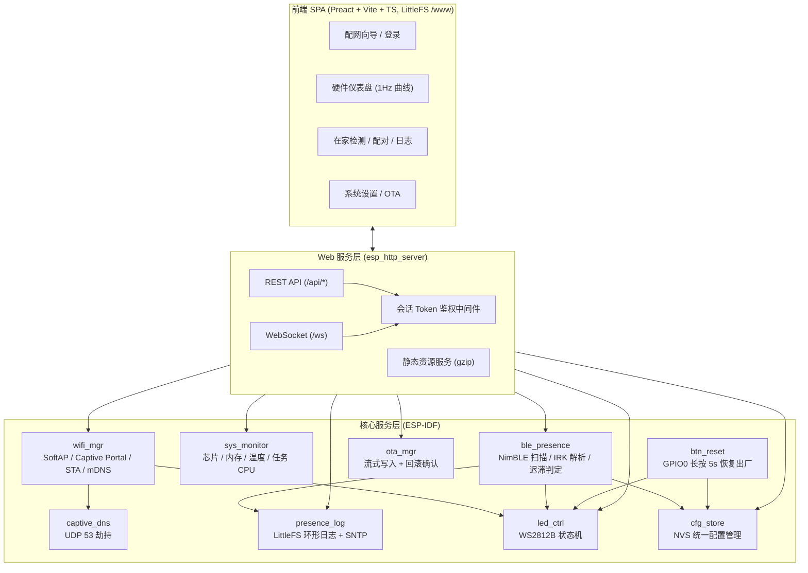
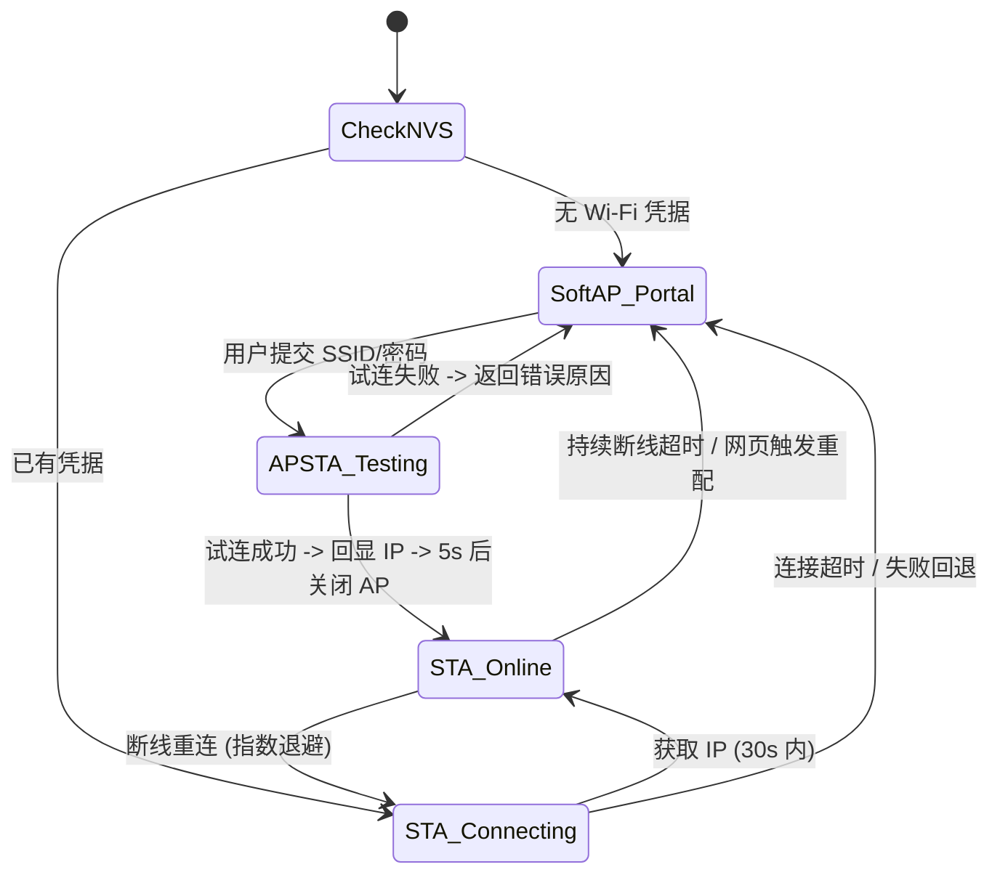

# SSP32S3-Platform 设计文档

> 面向 **ESP32-S3-DevKitC-1 (N16R8)** 的嵌入式 Web 管理与 BLE 在家检测平台。  
> 本文档作为工程实现规格书，覆盖硬件配置、分区表、软件架构、协议接口、核心算法与分阶段验收标准，可直接用于代码生成与开发实施。

---

## 1. 项目目标与核心特性

1. **零门槛网页配网**：首次上电自动开启 SoftAP + Captive Portal（强制门户），手机连上热点后自动弹出配网页；配网成功后切回 STA 模式并通过 mDNS（`http://ssp32s3.local`）访问；连接失败自动回退 AP；长按 BOOT 键恢复出厂。
2. **硬件状态实时仪表盘**：通过 WebSocket（1Hz）推送芯片信息、内部 SRAM / 8MB PSRAM / 16MB Flash 分区、芯片温度、FreeRTOS 任务 CPU 占用、Wi-Fi 与 BLE 状态，前端离线渲染实时曲线。
3. **BLE 在家检测 / 靠近感应**：
   - 支持 **配对 + IRK 解析**（识别 iOS / Android 随机 MAC 手机，无需安装 App）与 **固定 MAC 绑定**（手环、蓝牙标签等）。
   - 以“人”为维度管理多台设备（任一设备在场即判定在家）。
   - 采用 RSSI 滑动滤波 + 双阈值迟滞算法，提供实时 RSSI 曲线辅助校准。
   - 状态变化触发 **板载 WS2812B RGB LED 指示** 与 **Flash 持久化进出日志**（带 SNTP 对时）。
4. **安全与运维**：首次配网设置网页管理密码（会话 Token 鉴权），支持网页上传 `.bin` 进行双分区 OTA 升级与失败自动回滚。

---

## 2. 目标硬件与开发环境

| 项目 | 规格 / 配置 |
| --- | --- |
| 开发板 | ESP32-S3-DevKitC-1（ESP32-S3-WROOM-1-N16R8） |
| Flash | 16MB（QIO，80MHz） |
| PSRAM | 8MB Octal（OPI，80MHz）—— **注意：GPIO35 / GPIO36 / GPIO37 被 OPI PSRAM 占用，严禁复用** |
| 板载 RGB LED | WS2812B，默认 **GPIO48**（支持 Kconfig 与网页设置修改引脚及亮度） |
| 恢复出厂按键 | 板载 BOOT 键，**GPIO0**（低电平有效，长按 ≥ 5s 触发） |
| 开发框架 | **ESP-IDF v5.5.x**（已确认本地环境为 v5.5.4，原生 C/C++ + CMake） |
| 蓝牙协议栈 | **NimBLE**（`CONFIG_BT_NIMBLE_ENABLED=y`）+ Wi-Fi/BLE 软件共存 |
| 前端技术栈 | **Preact + Vite + TypeScript**（全离线构建，无 CDN 依赖，gzip 压缩后烧录至 `www` 分区） |

### 2.1 ESP-IDF 托管组件（`main/idf_component.yml`）

- `joltwallet/littlefs`: LittleFS 文件系统支持（用于 `www` 与 `data` 分区）
- `espressif/led_strip`: RMT 驱动 WS2812B RGB LED
- `espressif/mdns`: mDNS 域名广播（`ssp32s3.local`）

### 2.2 关键 `sdkconfig.defaults` 配置项

```ini
# Target & Flash / PSRAM (N16R8)
CONFIG_IDF_TARGET="esp32s3"
CONFIG_ESPTOOLPY_FLASHSIZE_16MB=y
CONFIG_ESPTOOLPY_FLASHMODE_QIO=y
CONFIG_ESPTOOLPY_FLASHFREQ_80M=y
CONFIG_SPIRAM=y
CONFIG_SPIRAM_MODE_OCT=y
CONFIG_SPIRAM_SPEED_80M=y
CONFIG_SPIRAM_USE_MALLOC=y
CONFIG_SPIRAM_MALLOC_ALWAYSINTERNAL=16384

# Partition Table & OTA Rollback
CONFIG_PARTITION_TABLE_CUSTOM=y
CONFIG_PARTITION_TABLE_CUSTOM_FILENAME="partitions.csv"
CONFIG_BOOTLOADER_APP_ROLLBACK_ENABLE=y

# FreeRTOS Runtime Stats (for Task CPU usage)
CONFIG_FREERTOS_USE_TRACE_FACILITY=y
CONFIG_FREERTOS_USE_STATS_FORMATTING_FUNCTIONS=y
CONFIG_FREERTOS_GENERATE_RUN_TIME_STATS=y

# HTTP Server & WebSocket
CONFIG_HTTPD_WS_SUPPORT=y
CONFIG_HTTPD_MAX_REQ_HDR_LEN=1024
CONFIG_HTTPD_MAX_URI_LEN=512

# Bluetooth (NimBLE) & Wi-Fi Coexistence
CONFIG_BT_ENABLED=y
CONFIG_BT_NIMBLE_ENABLED=y
CONFIG_BT_NIMBLE_MAX_CONNECTIONS=3
CONFIG_BT_NIMBLE_MAX_BONDS=16
CONFIG_BT_NIMBLE_NVS_PERSIST=y
CONFIG_BT_NIMBLE_SM_LEGACY=y
CONFIG_BT_NIMBLE_SM_SC=y
CONFIG_ESP_COEX_SW_COEXIST_ENABLE=y

# Core Dump to Flash
CONFIG_ESP_COREDUMP_ENABLE_TO_FLASH=y
```

---

## 3. Flash 分区表（16MB，`partitions.csv`）

总容量 `16MB = 0x1000000`，OTA 分区按 64KB（`0x10000`）对齐：

```csv
# Name,   Type, SubType,  Offset,   Size,     Flags
nvs,      data, nvs,      0x9000,   0x6000,
otadata,  data, ota,      0xF000,   0x2000,
phy_init, data, phy,      0x11000,  0x1000,
ota_0,    app,  ota_0,    0x20000,  0x400000,
ota_1,    app,  ota_1,    0x420000, 0x400000,
www,      data, littlefs, 0x820000, 0x200000,
data,     data, littlefs, 0xA20000, 0x5D0000,
coredump, data, coredump, 0xFF0000, 0x10000,
```

| 分区 | 大小 | 用途 |
| --- | --- | --- |
| `nvs` | 24 KB | Wi-Fi 凭据、管理员密码哈希、人员与设备配置、NimBLE 绑定/IRK、LED 与 SNTP 设置 |
| `otadata` | 8 KB | OTA 启动槽位状态与回滚标志 |
| `ota_0` / `ota_1` | 各 4 MB | 双固件分区，支持网页升级与失败自动回滚 |
| `www` | 2 MB | LittleFS，存放前端静态资源（`.html.gz` / `.js.gz` / `.css.gz`） |
| `data` | ~5.81 MB | LittleFS，存放进出历史日志（环形文件，保留最近 1000 条） |
| `coredump` | 64 KB | 异常崩溃转储 |

---

## 4. 系统架构与目录结构

### 4.1 软件模块架构



### 4.2 推荐仓库目录结构

```text
ssp32s3-platform/
├── CMakeLists.txt
├── partitions.csv
├── sdkconfig.defaults
├── DESIGN.md
├── main/
│   ├── CMakeLists.txt
│   ├── idf_component.yml
│   ├── Kconfig.projbuild          # 默认 LED 引脚、SoftAP 前缀等编译期默认值
│   ├── app_main.c                 # 启动编排、OTA 自检确认
│   ├── cfg_store/                 # NVS 读写：Wi-Fi、Auth、Presence 配置、系统设置
│   ├── wifi_mgr/                  # SoftAP + Captive DNS + APSTA 试连 + STA 重连/回退 + mDNS + SNTP
│   ├── sys_monitor/               # 芯片/内存/分区/温度/FreeRTOS 任务 CPU 统计
│   ├── ble_presence/              # NimBLE 初始化、间歇扫描、配对模式、IRK/RPA 解析、迟滞状态机
│   ├── presence_log/              # LittleFS 环形日志（1000 条）写入/分页查询/清空
│   ├── led_ctrl/                  # WS2812B 优先级状态机（呼吸/闪烁/常亮）
│   ├── web_server/                # esp_http_server、静态 gzip 托管、Auth 中间件、REST 路由、WS 广播
│   ├── ota_mgr/                   # 流式 OTA 写入与校验
│   └── btn_reset/                 # GPIO0 长按检测（防抖 + 5s 恢复出厂）
└── web/                           # Preact + Vite + TypeScript 前端工程
    ├── package.json
    ├── vite.config.ts             # 开发代理 /api & /ws -> ESP32；构建产出 gzip 压缩文件
    ├── index.html
    └── src/
        ├── main.tsx
        ├── api/                   # REST 客户端 & WebSocket 自动重连封装
        ├── components/            # 轻量 Canvas/SVG 实时曲线、状态卡片、导航栏
        └── pages/
            ├── SetupWizard.tsx    # 首次配网 + 管理员密码设置
            ├── Login.tsx
            ├── Dashboard.tsx      # 硬件状态实时仪表盘
            ├── Presence.tsx       # 人员/设备管理、IRK 配对向导、扫描雷达、RSSI 曲线、日志
            └── Settings.tsx       # Wi-Fi 重配、密码、LED、SNTP/时区、OTA、重启/重置
```

---

## 5. 核心子系统详细设计

### 5.1 Wi-Fi 配网与网络状态机（`wifi_mgr`）



- **SoftAP 参数**：
  - SSID：`SSP32S3-XXXX`（`XXXX` 为 Base MAC 后 2 字节大写十六进制）。
  - 加密：WPA2-PSK。
  - 默认密码：由设备 MAC 通过固定算法（如 `SHA256(mac + salt)` 取 8 位易读字符，避开 `0/O/1/I/l`）确定性生成，**每次开机打印在串口日志**，确保每台设备唯一。
  - IP：`192.168.4.1/24`。
- **Captive Portal**：
  - 仅在 SoftAP 开启期间运行 UDP 53 端口 DNS 服务，将所有 `A` 记录解析到 `192.168.4.1`。
  - HTTP 服务器拦截常见系统探测路径（`/generate_204`、`/hotspot-detect.html`、`/connecttest.txt`、`/ncsi.txt`、`/canonical.html`）以及非本机 `Host` 请求，统一 `302` 重定向至 `http://192.168.4.1/`。
- **mDNS**：
  - STA 获取 IP 后启动 mDNS，主机名默认 `ssp32s3`（即 `http://ssp32s3.local`），注册 `_http._tcp` 端口 `80`。
- **SNTP 对时**：
  - 默认时区 `CST-8`，默认服务器 `ntp.aliyun.com`、`cn.pool.ntp.org`（均可在网页设置中修改并持久化至 NVS）。
  - 维护 `bool time_synced` 标志（系统时间 `>= 2024-01-01` 视为已同步）。
- **恢复出厂（`btn_reset`）**：
  - 监听 GPIO0（内置上拉），持续低电平 ≥ 5 秒触发：LED 进入快闪反馈 → 清空 NVS 中 Wi-Fi 凭据与管理员密码（可选择保留或清空人员配置，建议全清 NVS 命名空间并清空 NimBLE 绑定）→ 重启进入 SoftAP 模式。

---

### 5.2 硬件状态监控（`sys_monitor`）

通过 1Hz 定时采样并经 WebSocket 广播，同时提供 `GET /api/system/info`（静态信息）与 `GET /api/system/status`（实时快照）：

| 分类 | 字段与采集方式 |
| --- | --- |
| 芯片信息（静态） | 型号（`esp_chip_info`）、硅片版本、核数、CPU 主频（`esp_clk_cpu_freq`）、STA MAC、IDF 版本（`esp_get_idf_version`）、固件版本与编译时间（`esp_app_get_description`） |
| 内存状态 | 内部 SRAM：`heap_caps_get_total_size/free_size/minimum_free_size(MALLOC_CAP_INTERNAL)`；PSRAM：`MALLOC_CAP_SPIRAM` |
| Flash 与分区 | 遍历 `esp_partition_find`，返回分区名/类型/偏移/大小；调用 `esp_littlefs_info` 返回 `www` 与 `data` 分区已用/总容量 |
| 运行状态 | 运行时间 `esp_timer_get_time() / 1000000`；重启原因 `esp_reset_reason()`；芯片内部温度 `temperature_sensor_get_celsius()`；FreeRTOS 任务列表 `uxTaskGetSystemState()` 计算两次采样间隔内的各任务 CPU 占用百分比与剩余栈高水位 |
| 网络与蓝牙 | Wi-Fi 模式/SSID/RSSI/信道/IP/掩码/网关/DNS；BLE 运行状态（`idle`/`scanning`/`pairing`）、已绑定设备数、当前在场人数 |

> **实现注意**：`uxTaskGetSystemState` 计算任务 CPU 占比需保存上一次采样的 `ulRunTimeCounter` 快照并计算差值（delta），避免直接用开机累计值导致曲线不灵敏；任务数组分配在 PSRAM 或复用静态缓冲。

---

### 5.3 BLE 在家检测与 IRK 解析（`ble_presence`）

#### 5.3.1 Wi-Fi / BLE 共存与扫描策略

- 启用软件共存（`CONFIG_ESP_COEX_SW_COEXIST_ENABLE=y`）。
- 扫描采用 **约 30% 占空比的被动扫描**（如 `itvl = 160` 即 100ms，`window = 48` 即 30ms，`passive = 1`，`filter_duplicates = 0` 以持续获取 RSSI 更新）。
- 当执行 Wi-Fi 扫描或 OTA 写入时，临时暂停 BLE 扫描，完成后自动恢复，避免射频竞争导致超时。

#### 5.3.2 两种设备识别方式

1. **配对 + IRK 解析（手机等 RPA 随机地址设备）**：
   - 用户在网页点击“添加手机”，后端调用 `ble_presence_start_pairing(person_id, label, timeout_s=60)`。
   - 板子短暂开启可连接、可配对的 BLE 外设广播（设备名如 `SSP32S3-Pair`，开启 SMP Bonding）。
   - 用户在手机系统蓝牙设置中点击配对；配对完成触发 `BLE_GAP_EVENT_ENC_CHANGE` / `BLE_GAP_EVENT_REPEAT_PAIRING`。
   - 固件通过 `ble_store_read_peer_sec()` 提取对端 `irk[16]` 及身份地址，保存到 NVS 绑定表，随后自动断开连接并关闭外设广播，恢复纯扫描状态；通过 WebSocket 通知前端配对成功。
   - **RPA 解析**：扫描回调收到 `addr.type == BLE_ADDR_RANDOM` 且最高两位为 `01`（`addr[5] >> 6 == 1`，即 Resolvable Private Address）的广播包时：
     - 取 `prand = addr[3..5]`（3 字节）与 `hash = addr[0..2]`（3 字节）。
     - 遍历已保存的 IRK 列表，使用 `mbedtls_aes_crypt_ecb` 计算 `AES-128(IRK, 0x00*13 || prand)`（注意 BLE 规范大小端字节序：IRK 与 prand 需按大端输入 AES，取输出低 3 字节与 `hash` 比对）。
     - **性能优化**：对已解析成功的当前 RPA 建立短暂缓存表（`rpa_mac -> device_id`，TTL 15 分钟），同一手机每 15 分钟仅需做 1 次 AES 计算，极大降低 CPU 开销。
2. **固定 MAC 绑定（手环 / 蓝牙标签）**：
   - 维护一个最近 30 秒内扫描到的“附近设备”内存缓存（最多保留 64 个，按 RSSI 排序），供网页雷达列表展示（显示 MAC、地址类型、广播名、最新 RSSI）。
   - 用户在网页一键选择某设备并绑定到指定人员，写入 NVS。

#### 5.3.3 数据模型

- **人员（`Person`，上限 16 人）**：
  - `id` (uint8)
  - `name` (char[32])
  - `is_home` (bool，运行时计算：**其名下任一设备为 `HOME` 即判定该人在家**)
- **追踪设备（`TrackedDevice`，上限 32 台）**：
  - `id` (uint8)
  - `person_id` (uint8)
  - `label` (char[32]，如“小王的 iPhone”)
  - `match_type` (`MATCH_IRK` | `MATCH_FIXED_MAC`)
  - `irk[16]` 或 `mac[6]`
  - `enter_rssi` (int8，默认 `-75` dBm)
  - `exit_rssi` (int8，默认 `-85` dBm)
  - `away_timeout_s` (uint16，默认 `120` 秒)

#### 5.3.4 RSSI 滤波与双阈值迟滞状态机

- **RSSI 平滑**：收到匹配设备的广播包时，更新指数移动平均（EMA）：
  - 首次收到：`smoothed_rssi = raw_rssi`
  - 后续收到：`smoothed_rssi = 0.3 * raw_rssi + 0.7 * smoothed_rssi`
  - 更新 `last_seen_ms = now_ms`。
- **状态转换（每秒定时评估）**：
  - `AWAY -> HOME`：当 `now_ms - last_seen_ms < 5000` 且 `smoothed_rssi >= enter_rssi` 时立即切换为 `HOME`。
  - `HOME -> AWAY`：满足以下任一条件时切换为 `AWAY`：
    1. 超过 `away_timeout_s` 未收到该设备任何广播（兼容 iPhone 锁屏后稀疏广播）；
    2. 持续收到广播但 `smoothed_rssi < exit_rssi` 的连续时长达到迟滞确认时间（建议 `min(30s, away_timeout_s)`），防止在门口边缘抖动。
- **人员状态聚合与事件触发**：
  - 当某台设备状态变化时，重新计算所属 `Person` 的 `is_home`：
    - 若 `Person.is_home` 发生 `false -> true`：写入 `ARRIVE` 日志，推送 WS 事件，刷新 LED 状态。
    - 若 `Person.is_home` 发生 `true -> false`：写入 `LEAVE` 日志，推送 WS 事件，刷新 LED 状态。

---

### 5.4 进出历史日志（`presence_log`）

- 存储在 `data` 分区（挂载点 `/data`），采用双文件轮转或定长环形文件实现**保留最近 1000 条**（推荐定长结构体二进制环形文件 `/data/presence.bin`，每条固定 96 字节，1000 条仅 ~96KB，读写 $O(1)$、无 JSON 解析碎片、断电安全）。
- 单条记录字段：
  - `seq` (uint32 递增序号)
  - `timestamp` (int64，已对时为 Unix 秒，未对时为 0)
  - `uptime_s` (uint32，开机秒数，未对时作为回退显示)
  - `time_synced` (uint8)
  - `person_id` (uint8)
  - `person_name` (char[32])
  - `event` (`ARRIVE` / `LEAVE`)
  - `device_label` (char[32])
  - `rssi` (int8)
- 提供按倒序分页查询接口（`GET /api/presence/logs?limit=50&offset=0`）与清空接口（`DELETE /api/presence/logs`）。

---

### 5.5 板载 WS2812B RGB LED 状态机（`led_ctrl`）

默认驱动 **GPIO48**（可通过网页设置修改 GPIO 编号与全局亮度 `0–100%`，默认 `20%` 避免刺眼）。按**优先级从高到低**决定当前灯效：

| 优先级 | 状态 | 灯效 |
| --- | --- | --- |
| 1（最高） | 恢复出厂确认中 | 红白交替快闪 |
| 2 | OTA 固件升级中 | 紫色呼吸 / 快脉动 |
| 3 | BLE 配对模式中 | 青色快闪（2Hz） |
| 4 | SoftAP 配网模式 | 蓝色缓慢呼吸 |
| 5（常态） | 在家检测指示 | **有人在家**：常亮绿色；**全部离开**：常亮暗红或熄灭（网页可配） |

---

### 5.6 安全鉴权与 Web OTA（`web_server` & `ota_mgr`）

#### 5.6.1 鉴权机制

- **密码存储**：NVS 中存储 16 字节随机盐 + `SHA-256(salt || password)`（32 字节），不存明文。
- **首次初始化**：未设置密码时处于 `setup_required = true` 状态，仅放行配网与初始化接口（`POST /api/setup/init`、`GET /api/wifi/scan`、`POST /api/wifi/connect`、`GET /api/auth/status`），其余管理接口拒绝访问。
- **会话管理**：
  - `POST /api/auth/login` 验证密码后生成 32 字节随机 Token（`esp_fill_random`），存入内存会话表（最多 8 个活跃会话，空闲 24 小时过期）。
  - 通过 `Set-Cookie: sid=<token>; HttpOnly; SameSite=Lax; Path=/` 下发，同时兼容 `Authorization: Bearer <token>` 与 WebSocket 连接时的 Cookie 校验。
  - 登录失败连续 5 次触发 60 秒限流冷却。

#### 5.6.2 双分区 OTA 与自动回滚

- **上传接口**：`POST /api/ota`（`Content-Type: application/octet-stream`），流式读取 HTTP Body（分块 4KB）调用 `esp_ota_begin` → `esp_ota_write` → `esp_ota_end` → `esp_ota_set_boot_partition`。
- 写入前暂停 BLE 扫描；校验镜像头合法性；成功后返回 `200 OK` 并在 1 秒后 `esp_restart()`。
- **自检与回滚**：
  - 开启 `CONFIG_BOOTLOADER_APP_ROLLBACK_ENABLE=y`。
  - 新固件启动后，待 NVS、LittleFS、Wi-Fi、HTTP Server 均初始化成功（例如稳定运行 10 秒无崩溃），调用 `esp_ota_mark_app_valid_cancel_rollback()` 确认新固件有效；否则重启后 Bootloader 自动回滚至上一版本。

---

## 6. HTTP REST API 与 WebSocket 协议规范

### 6.1 REST API 一览

| 分组 | 方法与路径 | 鉴权 | 说明 |
| --- | --- | --- | --- |
| 鉴权 | `GET /api/auth/status` | 公开 | 返回 `{setup_required, authenticated, ap_mode, hostname}` |
| | `POST /api/setup/init` | 仅首次 | 设置初始管理员密码 |
| | `POST /api/auth/login` | 公开 | 登录 `{password}`，下发会话 Cookie |
| | `POST /api/auth/logout` | 需鉴权 | 注销当前会话 |
| | `POST /api/auth/password` | 需鉴权 | 修改密码 `{old_password, new_password}` |
| Wi-Fi | `GET /api/wifi/scan` | 首次/鉴权 | 触发扫描并返回周围 AP 列表（SSID/RSSI/加密/信道） |
| | `POST /api/wifi/connect` | 首次/鉴权 | 提交 `{ssid, password}`，APSTA 试连并返回分配的 IP |
| | `GET /api/wifi/status` | 需鉴权 | 当前 Wi-Fi 连接详情 |
| 系统 | `GET /api/system/info` | 需鉴权 | 芯片、Flash 分区表、固件版本等静态信息 |
| | `GET /api/system/status` | 需鉴权 | 当前一次完整运行快照（与 WS 负载一致） |
| | `GET /api/settings` | 需鉴权 | 获取系统设置（LED 引脚/亮度/离开灯效、SNTP 服务器、时区、mDNS 名） |
| | `PUT /api/settings` | 需鉴权 | 更新系统设置并立即生效 |
| | `POST /api/ota` | 需鉴权 | 二进制流上传新固件 `.bin` |
| | `POST /api/system/reboot` | 需鉴权 | 重启设备 |
| | `POST /api/system/factory-reset` | 需鉴权 | 清空 NVS 并重启至配网模式 |
| 在家检测 | `GET /api/presence/state` | 需鉴权 | 获取所有人员、绑定设备及当前在家状态/实时 RSSI |
| | `POST /api/presence/persons` | 需鉴权 | 新增人员 `{name}` |
| | `PUT /api/presence/persons/:id` | 需鉴权 | 重命名人员 |
| | `DELETE /api/presence/persons/:id` | 需鉴权 | 删除人员及其绑定设备 |
| | `POST /api/presence/devices` | 需鉴权 | 绑定固定 MAC 设备 `{person_id, label, mac, enter_rssi, exit_rssi, away_timeout_s}` |
| | `PUT /api/presence/devices/:id` | 需鉴权 | 修改设备名称或迟滞参数 |
| | `DELETE /api/presence/devices/:id` | 需鉴权 | 解绑设备（如为 IRK 设备同步删除 NimBLE 绑定） |
| | `POST /api/presence/pair/start` | 需鉴权 | 进入 BLE 配对模式 `{person_id, label, timeout_s}` |
| | `POST /api/presence/pair/stop` | 需鉴权 | 提前取消配对模式 |
| | `GET /api/presence/scan` | 需鉴权 | 获取附近扫描到的 BLE 设备列表（用于固定 MAC 一键添加） |
| | `GET /api/presence/logs` | 需鉴权 | 分页查询进出日志 `?limit=50&offset=0` |
| | `DELETE /api/presence/logs` | 需鉴权 | 清空历史日志 |

### 6.2 WebSocket 协议（`/ws`）

服务端每秒向所有已鉴权客户端推送 JSON 消息，按 `type` 区分：

```json
// 1. 硬件遥测（每 1 秒）
{
  "type": "telemetry",
  "uptime_s": 3621,
  "time_synced": true,
  "epoch": 1795514400,
  "temp_c": 41.2,
  "sram": { "total": 327680, "free": 142300, "min_free": 118400 },
  "psram": { "total": 8388608, "free": 8102400, "min_free": 8050000 },
  "wifi": { "mode": "STA", "ssid": "MyWiFi", "rssi": -54, "channel": 6, "ip": "192.168.1.42" },
  "ble": { "state": "scanning", "tracked": 3, "home_persons": 1 },
  "tasks": [
    { "name": "IDLE0", "cpu": 82.5, "core": 0, "stack_hwm": 1024 },
    { "name": "ble_task", "cpu": 4.1, "core": 0, "stack_hwm": 2048 }
  ]
}

// 2. 在家状态与实时 RSSI（每 1 秒，仅当存在绑定设备时推送，供前端绘制校准曲线）
{
  "type": "presence_tick",
  "persons": [
    {
      "id": 1, "name": "张三", "is_home": true,
      "devices": [
        { "id": 1, "label": "iPhone", "is_home": true, "rssi": -62, "raw_rssi": -60, "seen_ago_s": 1 }
      ]
    }
  ]
}

// 3. 瞬时事件推送（到家/离开/配对结果）
{ "type": "presence_event", "event": "ARRIVE", "person_id": 1, "person_name": "张三", "device": "iPhone", "rssi": -63, "epoch": 1795514400 }
{ "type": "pair_result", "status": "success", "device_id": 2, "label": "iPhone" }
```

---

## 7. 前端工程与构建集成（`web/`）

- **技术栈**：Preact + Vite + TypeScript，CSS 使用原生变量实现响应式深色/浅色仪表盘，图表采用轻量自绘 Canvas/SVG 折线图（保持总 gzip 体积在 30–60KB 内）。
- **零外部资源**：禁止引用任何外部字体、图标或 CDN 脚本，确保在无外网的 SoftAP 配网环境下 100% 正常加载。
- **构建产物**：Vite 构建时通过 `vite-plugin-compression` 生成 `.gz` 文件并清理未压缩副本，输出至 `web/dist/`。
- **CMake 集成**：在 `main/CMakeLists.txt` 中通过 `littlefs_create_partition_image(www ../web/dist FLASH_IN_PROJECT)` 自动打包并随 `idf.py flash` 烧录；静态文件请求自动映射 `<uri>` → `/www<uri>.gz` 并附加 `Content-Encoding: gzip`，SPA 前端路由未匹配时回退返回 `/www/index.html.gz`。
- **本地联调**：`web/vite.config.ts` 配置 `server.proxy` 将 `/api` 与 `/ws` 代理至局域网内的 `http://ssp32s3.local`，支持前端热更新调试。

---

## 8. 分阶段实施里程碑与验收标准

### M1：工程骨架、分区与配网闭环
- **交付物**：ESP-IDF 工程骨架、`partitions.csv`、`sdkconfig.defaults`、`cfg_store`、`wifi_mgr`（SoftAP + Captive DNS + APSTA + STA + mDNS）、`btn_reset`（GPIO0 5s）、`web_server` 静态托管、`web/` 基础框架与配网向导页。
- **验收标准**：
  1. `idf.py build` 无报错，烧录后自动创建 `SSP32S3-XXXX` 热点，串口打印唯一 8 位 WPA2 密码。
  2. 手机连热点自动弹出配网页，扫描并填写家庭 Wi-Fi 后成功联网，页面回显 STA IP。
  3. 电脑访问 `http://ssp32s3.local` 可打开页面；断电重启自动重连；故意填错密码或关闭路由器后自动回退 SoftAP；长按 BOOT 5 秒清除配置并回到 SoftAP。

### M2：硬件状态仪表盘
- **交付物**：`sys_monitor`（含内部温度、PSRAM/SRAM、分区表、FreeRTOS 任务 delta CPU 统计）、WebSocket `/ws` 1Hz 广播、前端 `Dashboard.tsx` 与实时折线图组件。
- **验收标准**：
  1. 网页正确识别 16MB Flash 与 8MB Octal PSRAM，分区使用量与实际一致。
  2. 温度、内存、Wi-Fi RSSI、各任务 CPU 占比每秒平滑刷新，长时间打开（≥ 30 分钟）无内存泄漏与 WS 断流。

### M3：BLE 在家检测、IRK 解析与 RGB LED
- **交付物**：`ble_presence`（NimBLE 共存扫描、配对模式、IRK 提取与 RPA 解析、EMA + 双阈值迟滞引擎）、`led_ctrl`（GPIO48 WS2812B 优先级状态机）、前端 `Presence.tsx`（人员/设备 CRUD、配对向导、扫描列表、实时 RSSI 校准曲线）。
- **验收标准**：
  1. 手机通过“添加手机”完成蓝牙配对，断开连接并等待手机切换随机 MAC 后，仍能稳定识别并在网页展示实时 RSSI 曲线。
  2. 手环/固定 MAC 设备可从扫描列表一键添加；同一人绑定多台设备时，任一在场即显示“在家”。
  3. 离开蓝牙范围超过设定超时（默认 120s）后判定“离开”，重新靠近至 `≥ -75dBm` 判定“到家”，过程中无频繁抖动。
  4. GPIO48 RGB LED 按优先级正确显示：配网蓝呼吸、配对青快闪、有人绿常亮、无人暗红/灭。

### M4：日志持久化、安全鉴权、SNTP 与 Web OTA
- **交付物**：`presence_log`（`/data` LittleFS 1000 条环形日志）、SNTP 对时、`web_server` 密码与会话 Token 鉴权中间件、`ota_mgr` 流式 OTA + 回滚确认、前端 `Login.tsx` 与 `Settings.tsx`。
- **验收标准**：
  1. 首次配网强制设置管理员密码；未登录访问 `/api/*` 与 `/ws` 返回 `401`。
  2. 进出事件带准确 CST-8 时间戳写入 Flash，断电重启后历史日志不丢失，超过 1000 条自动覆盖最旧记录。
  3. 通过网页上传新版本 `.bin` 固件成功重启切换至另一 OTA 槽位，新版本版本号在仪表盘可见；模拟启动异常时自动回滚至旧槽位。

---

## 9. 433MHz 台灯控制迁移方案（合并自 `light-control`）

> 本节记录将旧项目 `light-control`（ESP32-S3 + CC1101 433.92MHz OOK 台灯遥控）完整迁入 `ssp32s3-platform` 的设计规格。**硬件接线完全不变**。

### 9.1 硬件接线与外设共存

| 外设 | 引脚（GPIO 编号） | 通道 / 说明 |
| --- | --- | --- |
| CC1101 SPI | SCK=`12`, MISO=`13`, MOSI=`11`, CS=`10` | 软件片选，SPI2_HOST，等待 MISO (CHIP_RDYn) 拉低 |
| CC1101 GDO0 | `GPIO4` | RMT TX（DMA，1μs 分辨率）发射 OOK 脉冲 |
| CC1101 GDO2 | `GPIO5` | RMT RX（DMA，1μs 分辨率）录制遥控脉冲 |
| 板载 WS2812B | `GPIO48` | RMT TX（非 DMA），与 CC1101 RMT 通道无冲突 |
| BOOT 恢复出厂键 | `GPIO0` | 低电平有效，长按 ≥ 5s |
| OPI PSRAM（禁用） | `GPIO35 / 36 / 37` | 严禁复用 |

- **串口控制台**：与旧项目保持一致，仅启用左侧**原生 USB Serial/JTAG**（`CONFIG_ESP_CONSOLE_USB_SERIAL_JTAG=y`、`CONFIG_ESP_CONSOLE_SECONDARY_NONE=y`）。
- **板载 RGB LED 策略调整**：
  - 默认亮度由 `20%` 调整为 **`10%`**。
  - 在系统设置中新增 **`led_idle_enabled`**（常态指示开关，默认开启；关闭后在非配网/非配对/非 OTA/非恢复出厂的常态下完全熄灭 GPIO48 RGB 灯，兼顾桌面/床头防眩光需求）。

### 9.2 旧样本备份与迁移流程

旧项目 `light-control` 使用 4MB 分区表，其中已学习的 `power_sample_1.rf` 及用灯历史文件存放在 SPIFFS 分区（偏移 `0x190000`，大小 `0x270000`）。**在烧录新平台固件前，必须先只读备份该分区**：

1. 插入开发板（左侧原生 USB 口），运行备份提取脚本：
   ```bash
   python3 scripts/backup_old_lamp.py
   ```
2. 脚本通过 `esptool read_flash 0x190000 0x270000` 只读导出旧 SPIFFS 镜像至 `backup_old_lamp/old_spiffs.bin`（不修改板子任何数据），解析并 CRC32 校验 `power_sample_1.rf`（及已有每日用灯历史文件），拷贝至 `data_seed/`。
3. 新平台统一使用 `/data` LittleFS 分区存放台灯波形（`/data/power_sample_1.rf`）与用灯历史日志（兼容原 32 字节定长 CRC32 每日日志文件格式），无需额外 SPIFFS 分区；若存在 `data_seed/`，可打包为初始 `data` 镜像或在首次烧录后通过网页/工具导入。

### 9.3 固件新增模块（`main/lamp_ctrl/`）

- `cc1101.c/h`：移植自 `light-control`，SPI 驱动、433.92 MHz / 325 kHz / 4.8 kBaud OOK 配置读回与 RX/TX 状态确认。
- `waveform.c/h`：移植自 `light-control`，1μs 分辨率 RMT DMA 收发（缓冲区优先分配在 PSRAM 或 DMA 内部内存，保持 4096 symbol 容量）。
- `rf_storage.c/h`：将原 `storage.c` 改为直接读写已挂载的 `/data/<name>.rf`（LittleFS），保持 `MAGIC = 0x49444631` 与 CRC32 格式 100% 兼容旧样本。
- `lamp_history.c/h`：移植自 `light-control/main/history.c`，沿用 `/data` 路径与 32 字节定长 CRC32 每日记录格式、12 个月自动清理与 NVS 检查点机制，并新增 `HISTORY_AUTO = 4`（蓝牙在家检测自动触发）。与 `wifi_mgr` 的 SNTP 对时同步调用 `lamp_history_clock_synced()`。
- `lamp_controller.c/h`：
  - 开关控制（单一切换命令 + 推算状态 + 重启后默认未校准 `power_known = false` + 网页手动校准）。
  - **网页信号学习流程**：
    1. `start`：进入学习模式，异步调用 `waveform_capture`（超时 10s，idle 20ms，filter 1μs）录制到临时缓冲 `pending_wave`，通过 WebSocket 推送 `lamp_learn` 结果（脉冲数、时长、频率）。
    2. `test`：试播 `pending_wave` 验证台灯是否实际开关。
    3. `save`：写入 `/data/power_sample_1.rf` 并设为当前生效样本。
    4. `cancel`：放弃临时样本。
- **与蓝牙在家检测的可选联动**：
  - NVS 设置项：`lamp_auto_off_on_away`（最后一人离开自动关灯，默认 `false`）、`lamp_auto_on_on_arrive`（第一人到家自动开灯，默认 `false`）。
  - **安全守卫**：仅当 `power_known == true`（已校准）且 `sample_loaded == true` 时才触发；若当前推算状态已与目标一致则不发射；触发时同时记录到 `lamp_history`（`HISTORY_AUTO`）和 `presence_log` 并推送 WS 事件。

### 9.4 新增 REST API 与 WebSocket 消息

| 方法与路径 | 鉴权 | 说明 |
| --- | --- | --- |
| `GET /api/lamp/state` | 需鉴权 | 返回 `radio_ready`、`sample_loaded`、`power_known`、`power_on`、`power_transmissions`、`last_action`、`last_error`、`history_status`、`automation`、`learning` 状态 |
| `POST /api/lamp/action` | 需鉴权 | `{action: "on" \| "off" \| "calibrate_on" \| "calibrate_off"}` 执行开/关或状态校准 |
| `GET /api/lamp/history` | 需鉴权 | `?from=<utc_s>&to=<utc_s>`（最多 31 天，按北京时间零点对齐）返回用灯区间数组 |
| `PUT /api/lamp/automation` | 需鉴权 | `{auto_off_on_away: bool, auto_on_on_arrive: bool}` 更新联动开关 |
| `POST /api/lamp/learn/start` | 需鉴权 | 开始 10 秒 433MHz 信号录制（异步，结果经 WS `lamp_learn` 推送） |
| `POST /api/lamp/learn/test` | 需鉴权 | 试播刚录制的临时信号 |
| `POST /api/lamp/learn/save` | 需鉴权 | 保存临时信号覆盖 `power_sample_1.rf` |
| `POST /api/lamp/learn/cancel` | 需鉴权 | 取消学习并清空临时缓冲 |

- **WebSocket 新增推送**：
  - `lamp_state`：开关状态、校准状态、联动触发或学习结果变化时即时广播。
  - `lamp_learn`：`{type: "lamp_learn", status: "listening" | "captured" | "timeout" | "error", pulses?: number, duration_ms?: number, error?: string}`。

### 9.5 前端「台灯」页（`web/src/pages/Lamp.tsx`）

采用新平台统一的 Preact + 深色风格重写（不引入 Three.js，保持整站 gzip 体积在 ~25KB 左右）：

1. **主控与校准区**：大号开/关切换按钮、当前推算状态徽章；未校准或与实物不一致时可一键点击「校准：当前已开灯 / 当前已关灯」。
2. **遥控信号学习向导**：显示当前样本状态（已加载脉冲数/频率）；支持「开始录制（10s 倒计时）→ 试播验证 → 保存生效」三步向导。
3. **蓝牙在家联动开关**：独立开关控制「最后一人离开自动关灯」与「第一人到家自动开灯」（默认关闭，附带“需已校准后生效”提示）。
4. **用灯统计与历史**：复用原 `stats.js` 的北京时间日历与区间统计逻辑（TypeScript 重写）：今日 24 小时时间轴、开关与校准事件列表、周/月每日用灯时长柱状图、总时长与有效记录日均时长。

### 9.6 里程碑 M5 验收标准

1. `scripts/backup_old_lamp.py` 成功从旧板子只读备份并 CRC32 校验提取 `power_sample_1.rf`。
2. 新固件集成 CC1101 + RMT DMA + LED GPIO48 + NimBLE + Wi-Fi 无通道冲突、编译零警告，且左侧原生 USB 正常输出日志。
3. 网页「台灯」页可加载旧样本或通过网页学习新样本，实物可靠开关台灯，状态校准与日/周/月用灯统计正常持久化。
4. 开启联动后，仅在已校准状态下于最后一人离开/第一人到家时自动关灯/开灯；常态关闭 LED 选项生效。

